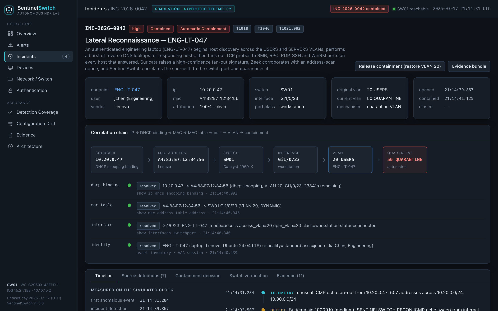
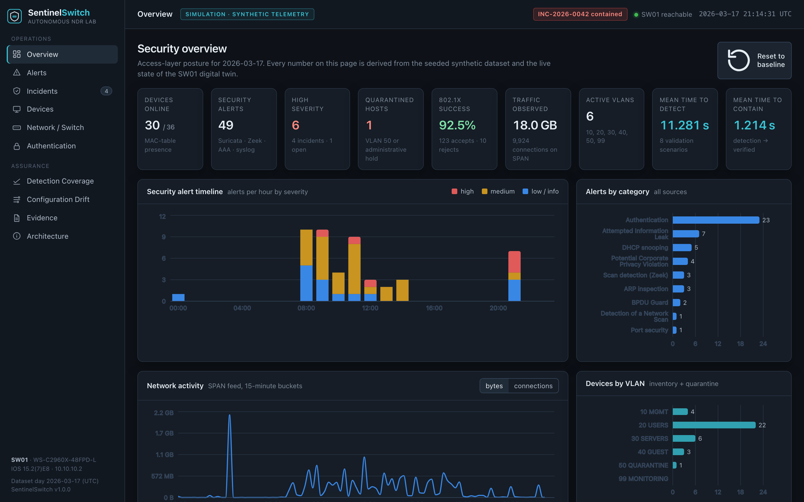

<p align="center">
  
</p>

# SentinelSwitch

**Autonomous Network Detection & Response Lab** — a reproducible digital twin of a Cisco Catalyst
2960-X access layer that models the telemetry, detection, attribution and containment pipeline of an
enterprise network-security environment. The repository ships with deterministic synthetic telemetry
so the complete incident lifecycle — from the first anomalous flow to a verified quarantine VLAN
change and an evidence bundle — can be replayed end to end without external infrastructure.

*Detect · Attribute · Contain.*

[](backend/tests)
[](docs/validation.md)
[](pyproject.toml)
[](frontend)
[](LICENSE)

> The environment is modelled around a Catalyst 2960-X (WS-C2960X-48FPD-L) and a Linux ThinkPad
> hosting the security stack. All telemetry in this repository is **synthetic and deterministic**:
> it is generated by the simulator from one canonical model, no physical attacks were executed, and
> no production network was involved. The detection, attribution, policy and containment code that
> consumes it is real and tested.

## What it demonstrates

| Area | In the repository |
| --- | --- |
| Enterprise segmentation | six VLANs with intent-driven port profiles, protected infrastructure trunks, a parking VLAN for unused ports |
| Cisco access-layer security | 802.1X / MAB with FreeRADIUS, DHCP snooping, Dynamic ARP Inspection, IP Source Guard, sticky port security, BPDU Guard, storm control, management ACLs, SPAN |
| Telemetry | Zeek-style `conn` / `dns` / `ssl` / `http` / `notice` / `weird` logs, Suricata EVE with local rules, RADIUS results, IOS syslog — all consistent with one asset inventory |
| Detection engineering | normalization across four sources, declarative correlation rules with aggregation windows and additive evidence scoring, MITRE ATT&CK mapping |
| Attribution | IP → DHCP snooping binding → MAC → MAC table → interface → VLAN → identity, with explicit handling of unknown MACs, expired bindings, MAC movement, impersonation, trunks and protected ports |
| Automated containment | confidence/severity tiers, guards that can only downgrade, quarantine VLAN moves and administrative shutdowns through a `SwitchAdapter`, read-back verification, rollback |
| Evidence | per-incident bundles: timeline, source alerts, binding, MAC table, port before/after, decision, transcript, related Zeek records, generated report |
| Configuration as code | the running configuration is rendered from port intent; a drift engine reports deviations with recommended IOS commands |
| Validation | eight adversary scenarios replayed through the full pipeline with measured MTTD / MTTA / MTTC |
| Presentation | a dark SOC-style React dashboard, a paced terminal demo, publishable diagrams and media rendered from live state |

## Architecture


Simulated endpoints attach to the digital twin of SW01. A VLAN SPAN session feeds Zeek and Suricata
on the ThinkPad's sensor NIC; syslog and RADIUS complete the picture. The SentinelSwitch controller
normalizes the four sources, scores correlation rules, resolves the actor to a physical port, applies
policy, contains through the switch adapter, verifies, and writes evidence. The dashboard and API sit
on SQLite. More in [docs/architecture.md](docs/architecture.md); topology, pipeline and flow diagrams
are in [diagrams/svg](diagrams/svg).

## The flagship incident — INC-2026-0042

At 21:14 UTC on the dataset day, **ENG-LT-047** (10.20.0.47, user `jchen`, `Gi1/0/23`, VLAN 20), an
authenticated engineering laptop, begins host discovery across the USERS and SERVERS VLANs, bursts
reverse DNS lookups, then fans out SMB, RPC, RDP, SSH and WinRM probes to every host that answered.
Nothing is compromised — the anonymous SMB session against SRV-FILE01 is rejected — but the pattern
is unmistakable.



| time (UTC) | phase | what happened |
| --- | --- | --- |
| 21:14:31.284 | telemetry | ICMP echo sweep begins (10.20.0.0/24 and 10.30.0.0/24 at 90 pps) |
| 21:14:33.507 | alert | Suricata sid 1000010 (medium): ICMP echo sweep — 200th request |
| 21:14:36.108 | alert | Suricata sid 1000014 (low): reverse DNS lookup burst |
| 21:14:38.198 | alert | Suricata sid 1000021 (**high**): SMB probe fan-out — 8th host on 445 |
| 21:14:39.649 | alert | Zeek `Scan::Address_Scan`: 15 unique hosts on 445/tcp |
| 21:14:39.867 | detection | rule `lateral-reconnaissance` matched: confidence **0.97** (base 0.75 + Zeek 0.10 + ICMP sweep 0.07 + PTR burst 0.05) |
| 21:14:40.092 | correlation | DHCP snooping binding: 10.20.0.47 → A4:83:E7:12:34:56 (VLAN 20, Gi1/0/23) |
| 21:14:40.346 | correlation | MAC address table: A4:83:E7:12:34:56 → SW01 Gi1/0/23 |
| 21:14:40.439 | correlation | identity: ENG-LT-047, Lenovo, Ubuntu 24.04, jchen (Engineering), criticality standard |
| 21:14:40.585 | policy | automatic containment approved: high severity, 0.97 ≥ 0.95, unprotected access port |
| 21:14:41.000 | containment | `SW01 Gi1/0/23: switchport access vlan 20 → 50` (workflow WF-2026-0042-01) |
| 21:14:41.125 | verification | `show interfaces Gi1/0/23 switchport` → `Access Mode VLAN: 50 (QUARANTINE)`; MAC learned in VLAN 50 |
| 21:14:41.464 | evidence | `data/incidents/INC-2026-0042/` finalized: 11 artifacts, 895 related connections, 254 DNS records |

Time to detect **8.583 s**, time to attribute **0.572 s**, time to contain **1.258 s**, first packet
to verified containment **9.841 s** — all on the scenario's simulated clock, which is why every
surface (CLI, dashboard, evidence bundle, this README) reports the same numbers.

```
10.20.0.47 → A4:83:E7:12:34:56 → SW01 → Gi1/0/23 → VLAN 20 → VLAN 50
```

Before and after, as the switch reports it (`cisco/show-output/`):

```
pre-quarantine   Gi1/0/23  ENG-LT-047  connected  20  a-full a-1000 10/100/1000BaseTX
post-quarantine  Gi1/0/23  ENG-LT-047  connected  50  a-full a-1000 10/100/1000BaseTX
```

## Quick start

Requirements: Python 3.11+, Node 20+, `make`. Everything runs offline after installation.

```bash
make setup               # virtualenv, Python + Node dependencies, headless Chromium
make seed                # generate the dataset and load the baseline into SQLite
make demo                # replay INC-2026-0042 in the terminal
make dev                 # build the dashboard and serve http://127.0.0.1:8000
```

Or with Docker (dashboard opens in the contained state):

```bash
docker compose up --build
```

## Commands

| command | purpose |
| --- | --- |
| `make setup` | create `.venv`, install requirements, `pip install -e .`, `npm install`, Playwright Chromium |
| `make seed` | regenerate `data/`, `cisco/` artifacts and evidence bundles, load SQLite, run validation |
| `make demo` | reset, then replay the flagship incident with paced output (`scripts/demo.sh`) |
| `make dev` | build the React app and serve API + dashboard on port 8000 |
| `make dev-frontend` | Vite dev server with hot reload (proxies `/api` to 8000) |
| `make test` | 51 backend tests + frontend type-check |
| `make lint` | ruff (Python) and oxlint (TypeScript) |
| `make validate-security` | the eight-scenario validation harness |
| `make drift` | configuration drift report |
| `make diagrams` | render SVG, PNG and Mermaid from `diagrams/source/*.json` |
| `make screenshots` | regenerate dashboard screenshots, LinkedIn cards, GitHub images and branding |
| `make reset` | back to the baseline (Gi1/0/23 in VLAN 20, flagship bundle removed) |

The CLI behind the targets: `python -m sentinelswitch {generate,seed,reset,demo,validate,drift,show,status,serve}`.

## The dashboard



Ten views: Overview, Alerts, Incidents (with manual-review queue), Incident detail, Devices,
Network / Switch, Authentication, Detection Coverage, Configuration Drift, Evidence and Architecture.
Every number is derived from the seeded dataset and the live twin; views refresh over Server-Sent
Events when the demo runs or containment is released.


The front panel renders all 48 ports plus the SFP+ uplinks from twin state — connected, unused,
trunk/protected, SPAN destination, quarantined, err-disabled — and the console runs read-only IOS
`show` commands against the twin. Full-page captures of every view are in
[assets/screenshots](assets/screenshots).

## Detection pipeline

1. **Sensors.** Twelve local Suricata signatures ([detections/suricata/local.rules](detections/suricata/local.rules))
   and a Zeek policy with lowered scan thresholds plus a SumStats-based DNS anomaly notice
   ([detections/zeek](detections/zeek)). The switch contributes DAI, DHCP snooping, port-security,
   BPDU Guard and AAA messages.
2. **Normalization.** One event schema with actor keys (`actor_ip`, `mac`, `interface`) and
   enrichment (port class, gateway comparison, parsed notice fields).
3. **Correlation rules.** Eleven YAML rules in [detections/correlation](detections/correlation): a
   trigger, an aggregation window, a base confidence and weighted evidence features. Context is part
   of the score — an authorized scanner loses 0.35, a guest-VLAN source gains 0.03, a MAC that belongs
   to a server appearing on a workstation drop gains 0.20.
4. **Attribution.** [`CorrelationEngine`](backend/sentinelswitch/correlation/engine.py) records every
   hop with its source and status and raises flags: `no_binding`, `expired_binding`,
   `mac_not_learned`, `multiple_observations`, `mac_moved`, `mac_impersonation`, `protected_port`,
   `trunk_interface`, `static_inventory_fallback`, `unresolved`.

Details in [docs/detection-engineering.md](docs/detection-engineering.md).

## Containment logic

```
confidence ≥ 0.95 and severity high  → automatic containment
confidence ≥ 0.75                    → manual review (attribution attached, switch untouched)
otherwise                            → monitor

guards (downgrade only): protected ports Gi1/0/1 + Gi1/0/48 · trunks · SPAN destination ·
                         critical assets · unresolved attribution
actions: compromised host → quarantine VLAN 50 · rogue device → administrative shutdown
```

The controller applies the action through [`SimulatedCisco2960XAdapter`](backend/sentinelswitch/containment/adapters.py),
reads the interface back, and only then marks the action verified. The adapter refuses protected
interfaces on its own, independent of policy. Restores reverse the change and record who released
containment and why. Details in [docs/containment.md](docs/containment.md).

## Cisco security controls represented

`cisco/configs/SW01-baseline.cfg` is rendered from port intent; `SW01-running-config.txt` is the
observed twin state including three deliberate drift items. Twenty `show` transcripts are captured
before and after the flagship incident in `cisco/show-output/`.

| control | where |
| --- | --- |
| 802.1X + MAB, guest VLAN on no-response, periodic re-authentication | user ports |
| sticky port security (restrict) on workstation drops, two non-sticky addresses on conference drops | user / conference ports |
| DHCP snooping on VLANs 20/30/40/50, trusted only on the two infrastructure trunks | global + trunks |
| Dynamic ARP Inspection with src/dst MAC and IP validation, rate limit 15 pps | global + access ports |
| IP Source Guard (`ip verify source`), static `ip source binding` for servers | access ports |
| BPDU Guard, PortFast, storm control with trap action | access ports |
| unused ports shut down in VLAN 999, trunk native VLAN 999, `switchport nonegotiate` | unused / trunk ports |
| SSH-only VTYs with a management ACL, login blocking, AAA to RADIUS with local fallback | management plane |
| SPAN session 1 (VLANs 20/30/40 → Gi1/0/47), syslog + SNMP traps to the collector, NTP | telemetry |

## Security validation


```
SENTINELSWITCH SECURITY VALIDATION
Scenario                 Detect   Attribute   Contain   Conf    TTD        TTA       TTC
Unauthorized Endpoint    PASS     PASS        PASS      0.96    0.461 s    0.475 s   1.145 s
ARP Spoofing Attempt     PASS     PASS        PASS      0.99    5.087 s    0.547 s   1.257 s
Rogue DHCP               PASS     PASS        PASS      0.95    3.085 s    0.508 s   1.175 s
MAC Address Change       PASS     PASS        PASS      0.95    5.084 s    0.543 s   1.238 s
Port Scan                PASS     PASS        PASS      0.96    3.768 s    0.560 s   1.261 s
DNS Anomaly              PASS     PASS        PASS      0.99   64.004 s    0.543 s   1.239 s
Lateral Reconnaissance   PASS     PASS        PASS      0.97    8.583 s    0.572 s   1.258 s
STP/BPDU Violation       PASS     PASS        PASS      0.96    0.176 s    0.490 s   1.141 s

Mean Time To Detect     11.281 s   Mean Time To Attribute   0.530 s   Mean Time To Contain   1.214 s
```

Each scenario runs against an isolated copy of the twin; timings come from the scenario's simulated
clock and alert timestamps are derived from the traffic model (the SMB fan-out signature fires on the
eighth host probed, the DNS signatures on the 120th query). The DNS anomaly is slow on purpose:
statistical detections need a minute of volume. See [docs/validation.md](docs/validation.md).

## Repository structure

```
sentinelswitch/
├── backend/sentinelswitch/     FastAPI app, API routes, services, correlation, detection,
│   ├── simulator/              containment (policy, adapters, controller), drift, evidence,
│   └── ...                     validation harness, switch twin + IOS renderer, CLI
├── backend/tests/              51 pytest tests
├── frontend/                   React 19 + TypeScript + Vite dashboard (Recharts, SSE)
├── simulator/                  canonical fixtures, scenario definitions, deterministic generators
├── data/                       generated Zeek / Suricata / RADIUS / syslog datasets, seeds, evidence bundles
├── cisco/                      rendered configs, show-output transcripts, port templates
├── detections/                 Suricata local.rules, Zeek scripts, correlation rules
├── automation/                 containment policy, workflows, adapter configuration
├── diagrams/                   JSON sources, rendered SVG / PNG, generated Mermaid
├── assets/                     screenshots, LinkedIn cards, GitHub images, branding
├── docs/                       architecture, threat model, detection engineering, containment,
│                               validation, data model, demo guide, LinkedIn assets and post, resume bullets
└── scripts/                    bootstrap, demo, reset, test, screenshots, diagrams
```

## Testing

```bash
make test        # pytest (twin, correlation, policy, containment, detection, scenarios, drift, generators, API) + tsc
make lint        # ruff + oxlint
```

## Data and simulation

`make seed` runs the day simulation in `simulator/generators/run.py`: routine link events and
authentications, background traffic (DNS, TLS, SMB, Kerberos, NTP, updates, printing, backups), the
security scenarios that occur before the baseline instant — each replayed through the real pipeline
against the twin, including analyst restores — the deliberate configuration drift, and a dry run of
the flagship scenario for the post-quarantine transcripts. Alert timestamps are derived from traffic
rates and signature thresholds, so the rules, the dataset and the documentation cannot disagree.

| dataset | records |
| --- | --- |
| Zeek `conn` / `dns` / `ssl` / `http` / `notice` / `weird` | 9,924 / 4,102 / 2,925 / 103 / 3 / 26 |
| Suricata EVE (alerts / flow events, before the flagship incident) | 12 / 1,922 |
| RADIUS results (accept / reject / guest VLAN) | 123 / 10 / 3 |
| IOS syslog lines | 368 |
| alerts / detections / incidents before the flagship incident | 42 / 14 / 3 |
| devices in inventory (online at the baseline) | 36 (30) |

The generator is seeded and order-independent; `data/generated/manifest.json` records SHA-256
hashes and two runs produce identical files. Identities, addresses and vendors are fictional;
external services use RFC 5737 documentation ranges. See [docs/data-model.md](docs/data-model.md).

## Limitations

* The switch is a digital twin. `SimulatedCisco2960XAdapter` implements the adapter interface
  against local state; an SSH adapter for physical IOS is documented, not implemented.
* Sensor output is synthesized from a traffic model rather than captured packets; Zeek and Suricata
  are not executed. The rule and script sources are real and are what the sensor would load.
* Containment uses static VLAN reassignment, which suits a lab where RADIUS assigns no VLAN to
  corporate users. Production deployments should add RADIUS CoA so re-authentication cannot undo a
  quarantine.
* Timings are measured on the scenario's simulated clock with declared engine latencies, not on
  wall-clock execution of a live pipeline.

## Future extensibility

* `IOSSSHAdapter` (Netmiko/Scrapli) and a RADIUS CoA adapter behind the same `SwitchAdapter` interface.
* Replacing generated logs with Zeek/Suricata run on replayed pcaps from the same traffic model.
* Additional scenarios (rogue AP, VLAN hopping, credential replay) as YAML + emitter pairs.
* NetBox-backed inventory and a syslog/EVE ingestion path for live telemetry.

## Documentation

[architecture](docs/architecture.md) · [threat model](docs/threat-model.md) ·
[detection engineering](docs/detection-engineering.md) · [containment](docs/containment.md) ·
[validation](docs/validation.md) · [data model](docs/data-model.md) · [demo guide](docs/demo-guide.md) ·
[LinkedIn assets](docs/linkedin-assets.md) · [LinkedIn post](docs/linkedin-post.md) · [resume bullets](docs/resume-bullets.md)

## License

MIT — see [LICENSE](LICENSE).
