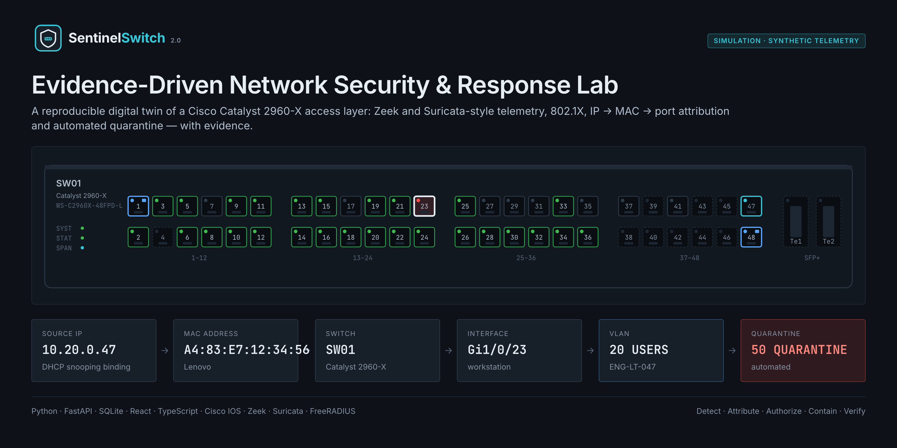
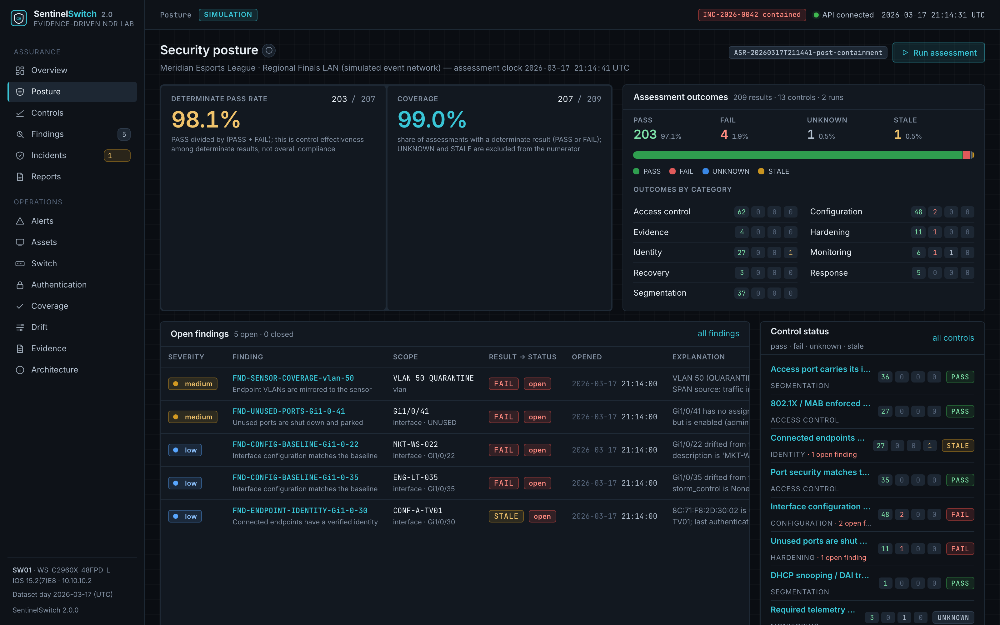
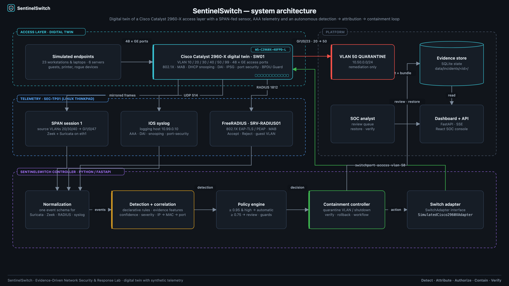
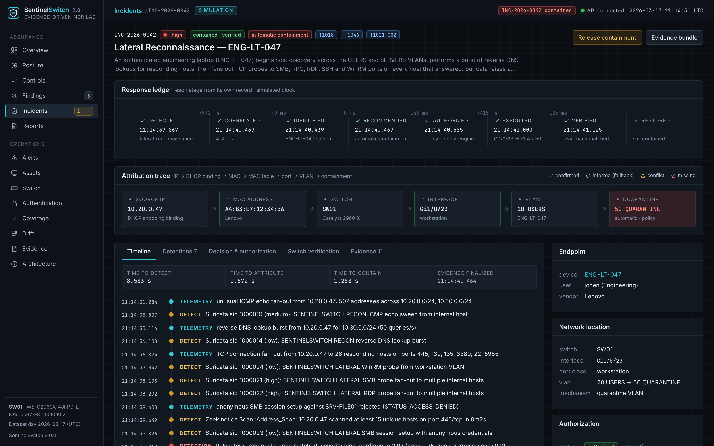
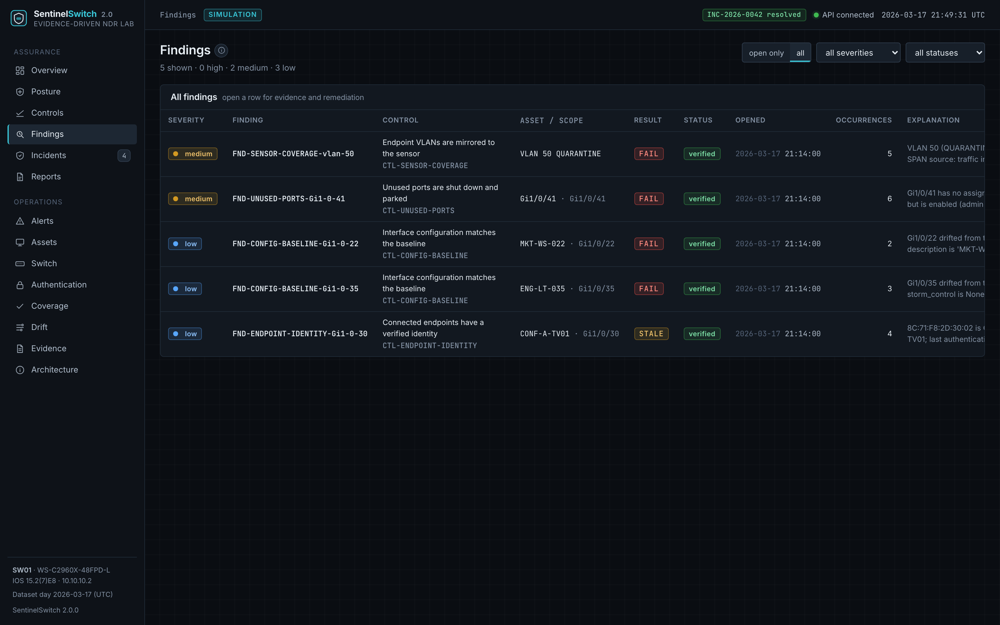
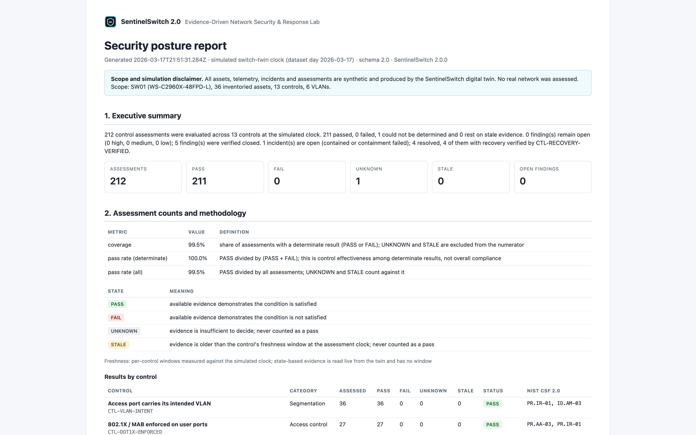
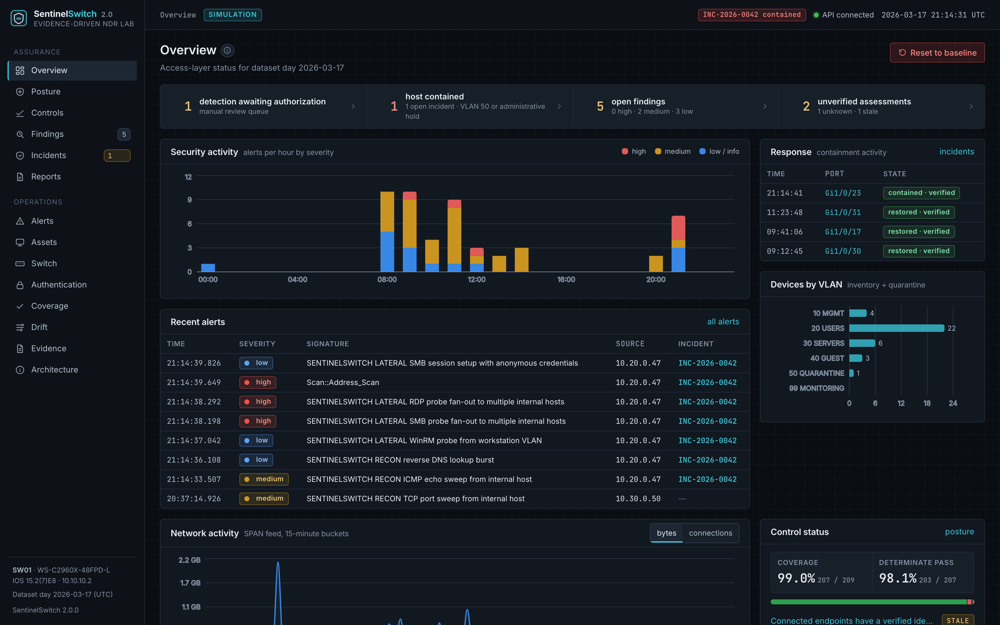
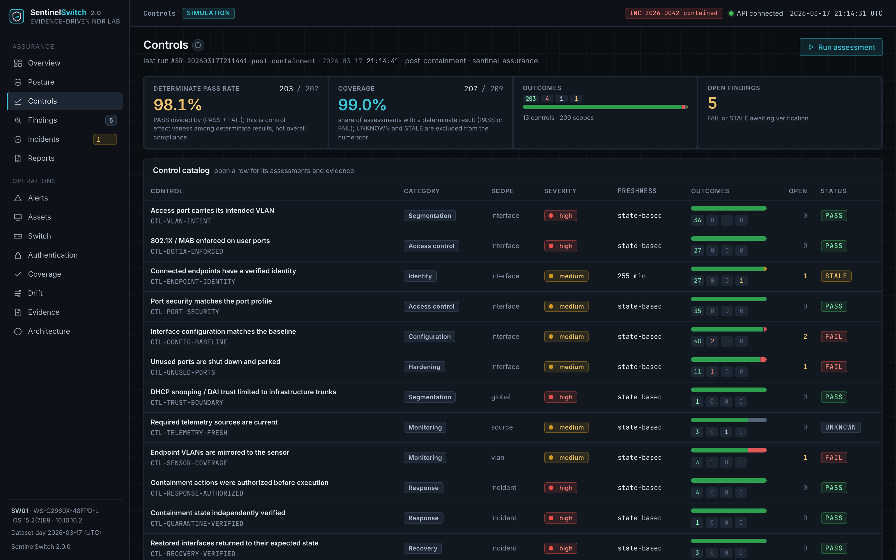
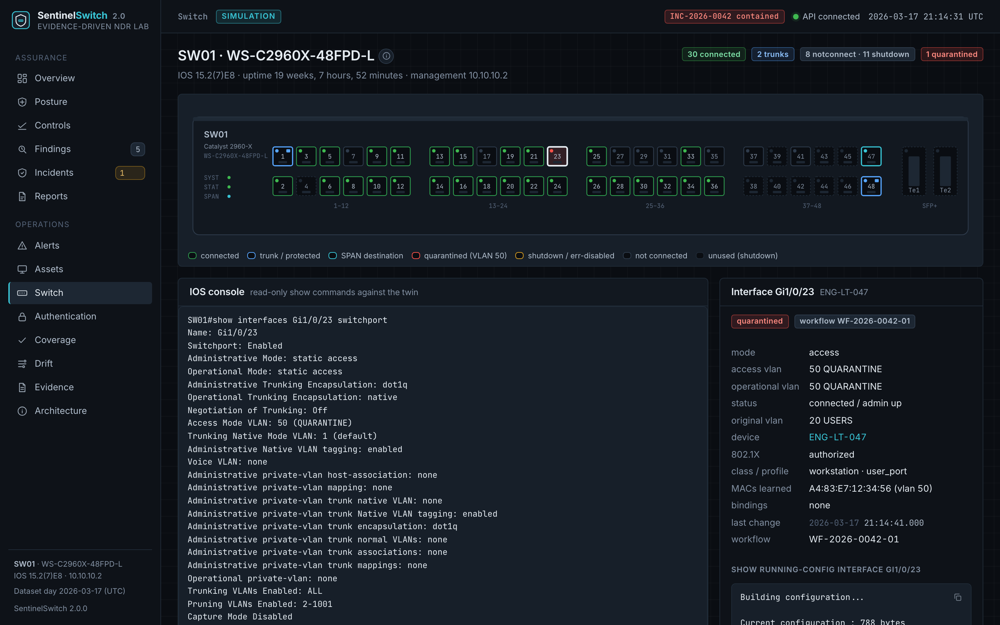
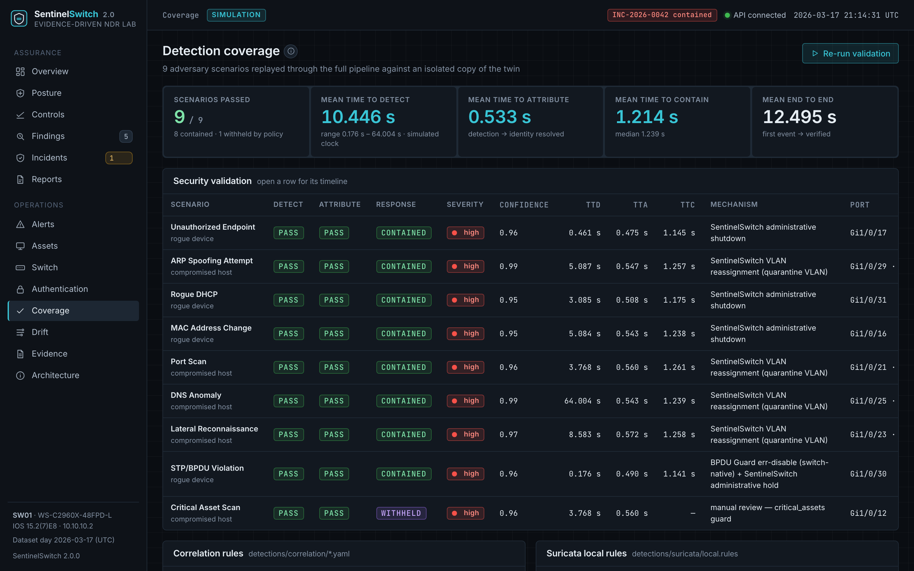

<p align="center">
  
</p>

# SentinelSwitch 2.0

**Evidence-Driven Network Security & Response Lab** — a reproducible digital twin of a Cisco Catalyst
2960-X access layer that models the telemetry, detection, attribution, authorization, containment,
verification, remediation and recovery pipeline of an enterprise network-security environment, and
continuously assesses the controls that pipeline relies on against evidence from the switch itself.

2.0 keeps everything from the original Autonomous Network Detection & Response Lab and adds an
**assurance layer**: thirteen control assessments with stable identifiers, an explainable posture
dashboard (counts with explicit denominators, never a composite "risk score"), a finding lifecycle
with executed and independently verified remediation, an explicit authorization step between
recommendation and execution, a negative path where automatic containment is withheld, and
exportable JSON / HTML / PDF posture reports with a documented schema.

*Detect · Attribute · Authorize · Contain · Verify · Remediate · Recover.*

[](backend/tests)
[](docs/validation.md)
[](docs/controls.md)
[](pyproject.toml)
[](frontend)
[](LICENSE)

> The environment is modelled around a Catalyst 2960-X (WS-C2960X-48FPD-L) and a Linux ThinkPad
> hosting the security stack, framed as the venue network of a fictional esports league. All telemetry
> in this repository is **synthetic and deterministic**: it is generated by the simulator from one
> canonical model, no physical attacks were executed, no real switch was touched and no production
> network was involved. The detection, attribution, policy, containment, assessment and reporting code
> that consumes it is real and tested. SentinelSwitch is an independent portfolio project with no
> affiliation to any vendor, employer or league.

## What's new in 2.0

| capability | what it means in the repository |
| --- | --- |
| Control assessments | 13 controls (`CTL-*`) evaluated against the twin, the port intent, the drift engine, RADIUS results, the SPAN session, containment records and evidence bundles — each with a stable id, expected vs observed values, the evidence that was read and a `PASS` / `FAIL` / `UNKNOWN` / `STALE` status |
| Freshness policy | time-bound evidence has a declared window; evidence older than the window becomes `STALE`, and `UNKNOWN` / `STALE` never count as a pass |
| Explainable posture | the dashboard reports *n of N* for every number (coverage, determinate pass rate, per-control status, open findings by severity); there is no weighted score |
| Findings lifecycle | `open → remediation_requested → remediated → verified`, with `reopened`, `remediation_failed` and `closed` (scope retired); every transition is recorded with actor, time and the assessment run that verified it |
| Executed remediation | remediation is applied through the same switch adapter as containment, then an assessment re-run must independently confirm the control passes |
| Authorization | every containment action carries an authorization record (policy tier or analyst decision) that must precede execution; a review can be rejected, and nothing touches the switch without it |
| Negative path | the `critical-asset-scan` scenario (SRV-GIT01 scanning from a critical asset) is detected and attributed but withheld by the `critical_assets` guard until an analyst decides |
| Recovery | releasing containment is itself verified: the recovery assessment confirms the port returned to its intended VLAN |
| Exports | `security-posture-report.json` (schema 2.0, documented in [docs/export-schema.md](docs/export-schema.md)), `security-posture-report.html` and, when headless Chromium is available, `security-posture-report.pdf` |
| Framework mapping | each control cites the NIST CSF 2.0 subcategories it supports (see [docs/controls.md](docs/controls.md)); the mapping is limited to what the control actually evidences |
| Deterministic 2.0 demo | `make demo-2` runs the whole workflow through the real pipeline and writes `artifacts/sentinelswitch-2.0/validation/demo-results.json` |



## Architecture



Simulated endpoints attach to the digital twin of SW01. A VLAN SPAN session feeds Zeek and Suricata
on the ThinkPad's sensor NIC; syslog and RADIUS complete the picture. The SentinelSwitch controller
normalizes the four sources, scores correlation rules, resolves the actor to a physical port, applies
policy, records an authorization, contains through the switch adapter, verifies by reading the
interface back, and writes evidence. The assurance layer sits beside it: the assessment engine reads
the same twin, intent, drift, RADIUS, SPAN and containment state, the remediation service applies
fixes through the same adapter, and the export module renders the posture and incident reports. The
dashboard and API sit on SQLite. More in [docs/architecture.md](docs/architecture.md); topology,
pipeline and flow diagrams are in [diagrams/svg](diagrams/svg).

```
telemetry ─▶ detection ─▶ correlation ─▶ identification ─▶ recommendation ─▶ authorization ─▶ execution ─▶ verification
                                                                                   │                              │
                                                                   analyst approve / reject            read-back of twin state
assessment engine ─▶ assessments (PASS/FAIL/UNKNOWN/STALE) ─▶ findings ─▶ remediation ─▶ re-assessment ─▶ verified
```

## Posture and control assessments

Every assessment answers one question about one scope (an interface, a VLAN, a telemetry source,
an incident, or the switch as a whole) and records what it expected, what it observed, where it looked
and when the evidence was produced. The thirteen controls:

| id | control | category | source of truth | states |
| --- | --- | --- | --- | --- |
| `CTL-VLAN-INTENT` | access port carries its intended VLAN (unless an authorized, verified containment moved it) | Segmentation | port intent vs twin interface state + containment actions | PASS / FAIL |
| `CTL-DOT1X-ENFORCED` | 802.1X / MAB enforced on user ports | Access control | port intent vs twin interface settings | PASS / FAIL |
| `CTL-ENDPOINT-IDENTITY` | every learned MAC is an inventoried asset with a fresh RADIUS result (window 4 h 15 min) | Identity | MAC table + inventory + auth events | PASS / FAIL / UNKNOWN / STALE |
| `CTL-PORT-SECURITY` | port security matches the port profile | Access control | port intent vs twin port-security settings | PASS / FAIL |
| `CTL-CONFIG-BASELINE` | no drift between rendered baseline and running configuration | Configuration | drift engine | PASS / FAIL |
| `CTL-UNUSED-PORTS` | unused ports shut down and parked in VLAN 999 | Hardening | port intent vs twin admin state / VLAN | PASS / FAIL |
| `CTL-TRUST-BOUNDARY` | DHCP snooping / DAI trust only on the infrastructure trunks | Segmentation | twin trust settings vs protected trunks | PASS / FAIL |
| `CTL-TELEMETRY-FRESH` | Zeek, RADIUS and syslog produced records within their windows; Suricata has no liveness signal in the dataset and is reported `UNKNOWN` | Monitoring | traffic buckets, auth events, twin log | PASS / STALE / UNKNOWN |
| `CTL-SENSOR-COVERAGE` | every endpoint VLAN (20, 30, 40, 50) is a SPAN source | Monitoring | twin SPAN session | PASS / FAIL |
| `CTL-RESPONSE-AUTHORIZED` | every executed containment has an authorization record that precedes execution | Response | containment actions | PASS / FAIL / UNKNOWN |
| `CTL-QUARANTINE-VERIFIED` | the twin currently reports the containment state recorded for each contained incident | Response | containment verification + live twin state | PASS / FAIL / UNKNOWN |
| `CTL-RECOVERY-VERIFIED` | restored interfaces are back in their intended VLAN and admin state | Recovery | restore records + intent + live twin state | PASS / FAIL |
| `CTL-EVIDENCE-COMPLETE` | every incident has all eleven evidence artifacts on disk | Evidence | `data/incidents/<id>/` | PASS / FAIL / UNKNOWN |

Status semantics are strict: `PASS` and `FAIL` require evidence inside the freshness window;
`UNKNOWN` means the evidence source produced nothing to evaluate; `STALE` means the evidence exists
but is older than the window. The posture page reports **coverage** (determinate assessments ÷ all
assessments) and the **determinate pass rate** (passes ÷ determinate assessments) separately, so a
control that cannot be evaluated is never hidden inside a percentage. Definitions, evaluators,
freshness windows and the NIST CSF 2.0 mapping are in [docs/controls.md](docs/controls.md).

At the seeded baseline the engine produces 206 assessments: 200 pass, 4 fail (two drifted
interfaces, one unused port left enabled, the quarantine VLAN missing from the SPAN session), 1
unknown (Suricata liveness) and 1 stale (a guest-VLAN identity older than its window), which open
five findings. Each deviation maps to exactly one finding: settings that a dedicated control owns are
excluded from the configuration-baseline check, so one remediation verifies one finding. After the
2.0 workflow every finding is verified and the recovery assessment reports 208 of 209 passing with one
`UNKNOWN` (Suricata liveness) that is deliberately *not* counted as a pass. A result whose scope no
longer exists — the quarantine verification of an incident that has since been resolved — is
**retired**: kept in history and in the export, excluded from every total.

## The incident workflow

The flagship incident is unchanged and still the centre of the story; 2.0 makes each stage of the
response explicit and inspectable in the incident detail view and the evidence bundle.

| stage | what SentinelSwitch records |
| --- | --- |
| detection | the correlation rule, its confidence and every source alert that contributed |
| correlation | IP → DHCP snooping binding → MAC → MAC table → interface → VLAN, each hop with its source and status |
| identification | the inventory asset, owner, criticality and port class |
| recommendation | the policy tier (`automatic`, `manual_review`, `monitor`) and the guards that applied |
| authorization | who or what authorized the action — the policy engine for the automatic tier, a named analyst for reviews — and when; or a rejection |
| execution | the adapter call, the IOS commands and the workflow id |
| independent verification | the interface read back from the twin after execution (`show interfaces … switchport`, MAC table in the new VLAN) |
| remediation / recovery | the restore, who released containment and why, and the recovery assessment that confirmed the port is back in VLAN 20 |

### INC-2026-0042 — automatic containment

At 21:14 UTC on the dataset day, **ENG-LT-047** (10.20.0.47, user `jchen`, `Gi1/0/23`, VLAN 20), an
authenticated engineering laptop, begins host discovery across the USERS and SERVERS VLANs, bursts
reverse DNS lookups, then fans out SMB, RPC, RDP, SSH and WinRM probes to every host that answered.
Nothing is compromised — the anonymous SMB session against SRV-FILE01 is rejected — but the pattern
is unmistakable.



| time (UTC) | phase | what happened |
| --- | --- | --- |
| 21:14:31.284 | telemetry | ICMP echo sweep begins (10.20.0.0/24 and 10.30.0.0/24 at 90 pps) |
| 21:14:33.507 | alert | Suricata sid 1000010 (medium): ICMP echo sweep — 200th request |
| 21:14:36.108 | alert | Suricata sid 1000014 (low): reverse DNS lookup burst |
| 21:14:38.198 | alert | Suricata sid 1000021 (**high**): SMB probe fan-out — 8th host on 445 |
| 21:14:39.649 | alert | Zeek `Scan::Address_Scan`: 15 unique hosts on 445/tcp |
| 21:14:39.867 | detection | rule `lateral-reconnaissance` matched: confidence **0.97** (base 0.75 + Zeek 0.10 + ICMP sweep 0.07 + PTR burst 0.05) |
| 21:14:40.092 | correlation | DHCP snooping binding: 10.20.0.47 → A4:83:E7:12:34:56 (VLAN 20, Gi1/0/23) |
| 21:14:40.346 | correlation | MAC address table: A4:83:E7:12:34:56 → SW01 Gi1/0/23 |
| 21:14:40.439 | identification | ENG-LT-047, Lenovo, Ubuntu 24.04, jchen (Engineering), criticality standard |
| 21:14:40.585 | recommendation + authorization | automatic tier: high severity, 0.97 ≥ 0.95, unprotected access port — authorized by the policy engine |
| 21:14:41.000 | execution | `SW01 Gi1/0/23: switchport access vlan 20 → 50` (workflow WF-2026-0042-01) |
| 21:14:41.125 | verification | `show interfaces Gi1/0/23 switchport` → `Access Mode VLAN: 50 (QUARANTINE)`; MAC learned in VLAN 50 |
| 21:14:41.464 | evidence | `data/incidents/INC-2026-0042/` finalized: 11 artifacts, related connections and DNS records |

Time to detect **8.583 s**, time to attribute **0.572 s**, time to contain **1.258 s**, first packet
to verified containment **9.841 s** — all on the scenario's simulated clock, which is why every
surface (CLI, dashboard, evidence bundle, report, this README) reports the same numbers.

```
10.20.0.47 → A4:83:E7:12:34:56 → SW01 → Gi1/0/23 → VLAN 20 → VLAN 50
```

### Critical Asset Scan — containment withheld

Earlier the same evening **SRV-GIT01** (10.30.0.50, `Gi1/0/12`, SERVERS VLAN, criticality critical)
port-scans the server segment. The detection scores 0.96 and attribution resolves cleanly to the
port, so the policy would otherwise act automatically — but the `critical_assets` guard downgrades
the recommendation to manual review. The review carries the full attribution, the switch is not
touched, and the detection waits in the queue. In the 2.0 demo the analyst rejects containment
(the scan was an unscheduled but benign repository migration check); the rejection is recorded as
the authorization decision and the assessment `CTL-RESPONSE-AUTHORIZED` confirms that no action
executed without one.

## Findings and remediation

A failed assessment opens a finding with a stable id derived from the control and scope
(`FND-CONFIG-BASELINE-Gi1-0-22`). Requesting remediation records the actor and note, executes the
control's remediation through the switch adapter (re-applying the baseline configuration, parking
unused ports, adding a SPAN source, re-authenticating a session), then runs a scoped assessment: only
if that run passes does the finding become `verified`. If the adapter refuses — protected trunks and
the SPAN destination are never modified — the finding becomes `remediation_failed` and stays open.
Every transition is in `finding_events`, and the full history is shown on the finding page and in the
export.



## Exports and reports

| output | produced by | contents |
| --- | --- | --- |
| `artifacts/sentinelswitch-2.0/reports/security-posture-report.json` | `make demo-2`, `make report`, `POST /api/reports/generate` | schema 2.0: posture totals, every control, assessment and finding (with events), assets with open findings, unverified items, assessment runs, incidents with their authorization / verification records, manual reviews, containment actions, validation results, framework mapping, limitations, reproducibility notes |
| `…/security-posture-report.html` | same | a self-contained ten-section report rendered from the same data |
| `…/security-posture-report.pdf` | same, when Playwright Chromium is installed | the HTML report printed to PDF |
| `artifacts/sentinelswitch-2.0/validation/demo-results.json` | `make demo-2` | every workflow step with the counts it observed |
| `artifacts/sentinelswitch-2.0/validation/test-results.md` | `scripts/test.sh` | the executed test, lint and validation run |

The schema is documented field by field in [docs/export-schema.md](docs/export-schema.md); the
`clock_basis` and `simulation_notice` fields state that timestamps are on the simulated clock and
that the data is synthetic.



## Quick start

Requirements: Python 3.11+, Node 20+, `make`. Everything runs offline after installation.

```bash
make setup               # virtualenv, Python + Node dependencies, headless Chromium
make seed                # generate the dataset, load the baseline, run the baseline assessment
make demo-2              # the 2.0 workflow: assess → incident → authorize → contain → verify → remediate → recover → export
make dev                 # build the dashboard and serve http://127.0.0.1:8000
```

`make demo` still replays the flagship incident alone in the terminal, as in 1.0. Or with Docker
(dashboard opens in the contained state):

```bash
docker compose up --build
```

## Commands

| command | purpose |
| --- | --- |
| `make setup` | create `.venv`, install requirements, `pip install -e .`, `npm install`, Playwright Chromium |
| `make seed` | regenerate `data/`, `cisco/` artifacts and evidence bundles, load SQLite, run validation and the baseline assessment |
| `make demo` | reset, then replay the flagship incident with paced output (`scripts/demo.sh`) |
| `make demo-2` | the deterministic 2.0 workflow (`python -m sentinelswitch demo2`); writes reports and `demo-results.json` |
| `make assess` | run the assessment engine against the current twin state |
| `make findings` | list open findings |
| `make remediate` | request, execute and verify remediation for every open finding with an executable action |
| `make report` | export the posture + incident report (JSON, HTML, PDF when Chromium is available) |
| `make dev` | build the React app and serve API + dashboard on port 8000 |
| `make dev-frontend` | Vite dev server with hot reload (proxies `/api` to 8000) |
| `make test` | backend tests + frontend type-check (`scripts/test.sh` adds lint and validation and writes `test-results.md`) |
| `make lint` | ruff (Python) and oxlint (TypeScript) |
| `make validate-security` | the nine-scenario validation harness |
| `make drift` | configuration drift report |
| `make diagrams` | render SVG, PNG and Mermaid from `diagrams/source/*.json` |
| `make screenshots` | regenerate dashboard screenshots, LinkedIn cards, GitHub images, branding and the 2.0 artifact screenshots |
| `make screenshots-2` | only the 2.0 artifact screenshots (`artifacts/sentinelswitch-2.0/screenshots/`) |
| `make reset` | back to the baseline (Gi1/0/23 in VLAN 20, flagship bundle removed) |

The CLI behind the targets: `python -m sentinelswitch {generate,seed,reset,demo,demo2,assess,findings,remediate,report,validate,drift,show,status,serve}`.

## The deterministic 2.0 demo

`make demo-2` executes the real pipeline end to end — nothing in it writes a predetermined result —
and records what it observed in `artifacts/sentinelswitch-2.0/validation/demo-results.json`:

| step | observed |
| --- | --- |
| reset + baseline assessment | 36 devices seeded; `ASR-…-baseline-seed`: 200 PASS, 4 FAIL, 1 UNKNOWN, 1 STALE (206 assessments, 5 findings) |
| flagship incident | INC-2026-0042 detected 21:14:39.867 Z at 0.97; Gi1/0/23 VLAN 20 → 50 verified 21:14:41.125 Z; authorization: policy engine, automatic tier |
| post-containment assessment | `CTL-QUARANTINE-VERIFIED` and `CTL-RESPONSE-AUTHORIZED` pass for the new incident; the quarantined port is excluded from `CTL-VLAN-INTENT` because its move is authorized and verified |
| negative path | DET-20260317T20371618-PORT (Critical Asset Scan, SRV-GIT01) withheld by the `critical_assets` guard, awaiting a decision |
| analyst decision | containment rejected by `tlee`; authorization recorded as `rejected`, switch untouched |
| remediation | five findings requested, executed through the adapter and verified by re-assessment |
| restore + recovery | INC-2026-0042 resolved; recovery assessment confirms Gi1/0/23 back in VLAN 20 and retires the incident's quarantine-verification row |
| final posture | 209 assessments: 208 PASS, 0 FAIL, 1 UNKNOWN, 0 STALE (1 retired); coverage 99.5 %, determinate pass rate 100 % |
| export | JSON, HTML and PDF reports written |

Because the simulator, the clock and the engines are deterministic, two runs produce the same
assessment ids, finding ids and counts. See [docs/workflow-2.0.md](docs/workflow-2.0.md) and
[docs/demo-guide.md](docs/demo-guide.md).

## The dashboard

The dashboard opens on the **Overview** (`/`): an attention strip (detections awaiting
authorization, contained hosts, open findings, unverified assessments), the alert stream, the
response ledger of recent containment actions, control status and telemetry freshness as of the last
assessment run. The navigation is split into **Assurance** (Overview, Posture at `/posture`,
Controls, Findings, Incidents, Reports) and **Operations** (Alerts, Assets, Switch, Authentication,
Coverage, Drift, Evidence, Architecture); `/operations` redirects to `/`. Every number is derived from
the seeded dataset and the live twin; views refresh over Server-Sent Events when the demo runs, a
finding is remediated or containment is released. Consequential actions (authorize or decline
containment, release containment, remediate, replay or reset the demo) confirm in a dialog that
states what will change; the backend authorization and guard checks are unchanged.







The front panel renders all 48 ports plus the SFP+ uplinks from twin state — connected, unused,
trunk/protected, SPAN destination, quarantined, err-disabled — and the console runs read-only IOS
`show` commands against the twin. Full-page captures of every view are in
[assets/screenshots](assets/screenshots); the 2.0 captures are in
[artifacts/sentinelswitch-2.0/screenshots](artifacts/sentinelswitch-2.0/screenshots).

## Detection pipeline

1. **Sensors.** Twelve local Suricata signatures ([detections/suricata/local.rules](detections/suricata/local.rules))
   and a Zeek policy with lowered scan thresholds plus a SumStats-based DNS anomaly notice
   ([detections/zeek](detections/zeek)). The switch contributes DAI, DHCP snooping, port-security,
   BPDU Guard and AAA messages.
2. **Normalization.** One event schema with actor keys (`actor_ip`, `mac`, `interface`) and
   enrichment (port class, gateway comparison, parsed notice fields).
3. **Correlation rules.** Eleven YAML rules in [detections/correlation](detections/correlation): a
   trigger, an aggregation window, a base confidence and weighted evidence features. Context is part
   of the score — an authorized scanner loses 0.35, a guest-VLAN source gains 0.03, a MAC that belongs
   to a server appearing on a workstation drop gains 0.20.
4. **Attribution.** [`CorrelationEngine`](backend/sentinelswitch/correlation/engine.py) records every
   hop with its source and status and raises flags: `no_binding`, `expired_binding`,
   `mac_not_learned`, `multiple_observations`, `mac_moved`, `mac_impersonation`, `protected_port`,
   `trunk_interface`, `static_inventory_fallback`, `unresolved`.

Details in [docs/detection-engineering.md](docs/detection-engineering.md).

## Containment logic

```
confidence ≥ 0.95 and severity high  → automatic containment (authorized by the policy engine)
confidence ≥ 0.75                    → manual review (attribution attached, switch untouched,
                                       analyst approves or rejects — the decision is the authorization)
otherwise                            → monitor

guards (downgrade only): protected ports Gi1/0/1 + Gi1/0/48 · trunks · SPAN destination ·
                         critical assets · unresolved attribution
actions: compromised host → quarantine VLAN 50 · rogue device → administrative shutdown
```

The controller refuses to execute without an authorization record whose status is `authorized`,
applies the action through [`SimulatedCisco2960XAdapter`](backend/sentinelswitch/containment/adapters.py),
reads the interface back, and only then marks the action verified. The adapter refuses protected
interfaces on its own, independent of policy. Restores reverse the change, record who released
containment and why, and trigger a recovery assessment. Details in [docs/containment.md](docs/containment.md).

## Cisco security controls represented

`cisco/configs/SW01-baseline.cfg` is rendered from port intent; `SW01-running-config.txt` is the
observed twin state including four deliberate drift items (three interface deviations and VLAN 50
missing from the SPAN session). Twenty `show` transcripts are captured
before and after the flagship incident in `cisco/show-output/`.

| control | where |
| --- | --- |
| 802.1X + MAB, guest VLAN on no-response, periodic re-authentication | user ports |
| sticky port security (restrict) on workstation drops, two non-sticky addresses on conference drops | user / conference ports |
| DHCP snooping on VLANs 20/30/40/50, trusted only on the two infrastructure trunks | global + trunks |
| Dynamic ARP Inspection with src/dst MAC and IP validation, rate limit 15 pps | global + access ports |
| IP Source Guard (`ip verify source`), static `ip source binding` for servers | access ports |
| BPDU Guard, PortFast, storm control with trap action | access ports |
| unused ports shut down in VLAN 999, trunk native VLAN 999, `switchport nonegotiate` | unused / trunk ports |
| SSH-only VTYs with a management ACL, login blocking, AAA to RADIUS with local fallback | management plane |
| SPAN session 1 (VLANs 20/30/40/50 → Gi1/0/47; VLAN 50 is missing at the baseline, which is both a drift item and a finding), syslog + SNMP traps to the collector, NTP | telemetry |

## Security validation



```
SENTINELSWITCH SECURITY VALIDATION
Scenario                 Detect   Attribute   Response    Conf    TTD        TTA       TTC
Unauthorized Endpoint    PASS     PASS        CONTAINED   0.96    0.461 s    0.475 s   1.145 s
ARP Spoofing Attempt     PASS     PASS        CONTAINED   0.99    5.087 s    0.547 s   1.257 s
Rogue DHCP               PASS     PASS        CONTAINED   0.95    3.085 s    0.508 s   1.175 s
MAC Address Change       PASS     PASS        CONTAINED   0.95    5.084 s    0.543 s   1.238 s
Port Scan                PASS     PASS        CONTAINED   0.96    3.768 s    0.560 s   1.261 s
DNS Anomaly              PASS     PASS        CONTAINED   0.99   64.004 s    0.543 s   1.239 s
Lateral Reconnaissance   PASS     PASS        CONTAINED   0.97    8.583 s    0.572 s   1.258 s
STP/BPDU Violation       PASS     PASS        CONTAINED   0.96    0.176 s    0.490 s   1.141 s
Critical Asset Scan      PASS     PASS        WITHHELD    0.96    3.768 s    0.560 s   —        (critical_assets guard)

9/9 scenarios met their expected outcome: 8 contained and verified, 1 withheld by policy for analyst review
Mean Time To Detect     10.446 s   Mean Time To Attribute   0.533 s   Mean Time To Contain   1.214 s (8 contained scenarios)
```

Each scenario runs against an isolated copy of the twin; timings come from the scenario's simulated
clock and alert timestamps are derived from the traffic model (the SMB fan-out signature fires on the
eighth host probed, the DNS signatures on the 120th query). The DNS anomaly is slow on purpose:
statistical detections need a minute of volume. The ninth scenario is a **validated safety decision,
not a containment**: its expected outcome is that automation is withheld. The harness checks that the
disposition is manual review, that the `critical_assets` guard fired and that the switch is untouched,
and it reports the result as WITHHELD; it records no time to contain. The analyst's rejection of that
review is exercised separately by `make demo-2`. See [docs/validation.md](docs/validation.md).

## Repository structure

```
sentinelswitch/
├── backend/sentinelswitch/     FastAPI app, API routes, services, correlation, detection,
│   ├── assurance/              controls catalog, assessment engine, posture summary, remediation, export
│   ├── simulator/              containment (policy, adapters, controller), drift, evidence,
│   └── ...                     validation harness, switch twin + IOS renderer, CLI
├── backend/tests/              pytest suite
├── frontend/                   React 19 + TypeScript + Vite dashboard (Recharts, SSE)
├── simulator/                  canonical fixtures, scenario definitions, deterministic generators
├── data/                       generated Zeek / Suricata / RADIUS / syslog datasets, seeds, evidence bundles
├── cisco/                      rendered configs, show-output transcripts, port templates
├── detections/                 Suricata local.rules, Zeek scripts, correlation rules
├── automation/                 containment policy, workflows (incl. analyst decision + finding remediation), adapter configuration
├── artifacts/sentinelswitch-2.0/  genuine screenshots, exported reports, demo + test results, portfolio package
├── diagrams/                   JSON sources, rendered SVG / PNG, generated Mermaid
├── assets/                     screenshots, LinkedIn cards, GitHub images, branding
├── docs/                       architecture, threat model, detection engineering, containment, controls,
│                               export schema, 2.0 workflow, validation, data model, demo guide, LinkedIn, resume
└── scripts/                    bootstrap, demo, reset, test, screenshots, diagrams
```

## Testing

```bash
make test        # pytest (twin, correlation, policy, containment, detection, scenarios, drift, generators,
                 #         API, assurance engine, response service, assurance API) + tsc
make lint        # ruff + oxlint
scripts/test.sh  # the above plus the validation harness, written to artifacts/sentinelswitch-2.0/validation/test-results.md
```

## Data and simulation

`make seed` runs the day simulation in `simulator/generators/run.py`: routine link events and
authentications, background traffic (DNS, TLS, SMB, Kerberos, NTP, updates, printing, backups), the
security scenarios that occur before the baseline instant — each replayed through the real pipeline
against the twin, including analyst restores — the deliberate configuration drift, and a dry run of
the flagship scenario for the post-quarantine transcripts. Alert timestamps are derived from traffic
rates and signature thresholds, so the rules, the dataset and the documentation cannot disagree.

| dataset | records |
| --- | --- |
| Zeek `conn` / `dns` / `ssl` / `http` / `notice` / `weird` | 10,524 / 4,102 / 2,925 / 103 / 4 / 26 |
| Suricata EVE (alerts / flow events, before the flagship incident) | 13 / 2,527 |
| RADIUS results (accept / reject / guest VLAN) | 123 / 10 / 3 |
| IOS syslog lines | 367 |
| alerts / detections / incidents / reviews before the flagship incident | 44 / 15 / 3 / 5 |
| devices in inventory | 36 |

The generator is seeded and order-independent; `data/generated/manifest.json` records SHA-256
hashes and two runs produce identical files. Identities, addresses and vendors are fictional;
external services use RFC 5737 documentation ranges. See [docs/data-model.md](docs/data-model.md).

## Limitations

* The switch is a digital twin. `SimulatedCisco2960XAdapter` implements the adapter interface
  against local state; an SSH adapter for physical IOS is documented, not implemented. No command in
  this repository is ever sent to real hardware.
* Sensor output is synthesized from a traffic model rather than captured packets; Zeek and Suricata
  are not executed. The rule and script sources are real and are what the sensor would load.
* Control assessments evaluate what the twin, the intent model and the generated telemetry can
  evidence. The Suricata liveness check is reported `UNKNOWN` because the dataset carries no stats
  events, and it stays out of the pass rate on purpose.
* The NIST CSF 2.0 mapping is a limited, control-by-control citation of subcategories, not a
  framework assessment or a compliance claim.
* Containment uses static VLAN reassignment, which suits a lab where RADIUS assigns no VLAN to
  corporate users. Production deployments should add RADIUS CoA so re-authentication cannot undo a
  quarantine.
* Timings are measured on the scenario's simulated clock with declared engine latencies, not on
  wall-clock execution of a live pipeline.
* The Docker image builds the frontend and installs the backend, but the image was not built in the
  2.0 release run because no Docker daemon was available on the authoring machine.

## Future extensibility

* `IOSSSHAdapter` (Netmiko/Scrapli) and a RADIUS CoA adapter behind the same `SwitchAdapter` interface.
* Replacing generated logs with Zeek/Suricata run on replayed pcaps from the same traffic model.
* Additional scenarios (rogue AP, VLAN hopping, credential replay) as YAML + emitter pairs.
* Additional controls (management-plane ACLs, NTP, logging targets) as evaluators in the same catalog.
* NetBox-backed inventory and a syslog/EVE ingestion path for live telemetry.

## Documentation

[architecture](docs/architecture.md) · [threat model](docs/threat-model.md) ·
[detection engineering](docs/detection-engineering.md) · [containment](docs/containment.md) ·
[controls and assessments](docs/controls.md) · [2.0 workflow](docs/workflow-2.0.md) ·
[export schema](docs/export-schema.md) · [validation](docs/validation.md) ·
[data model](docs/data-model.md) · [demo guide](docs/demo-guide.md) ·
[LinkedIn assets](docs/linkedin-assets.md) · [LinkedIn post](docs/linkedin-post.md) ·
[resume bullets](docs/resume-bullets.md) · [2.0 portfolio package](artifacts/sentinelswitch-2.0/PORTFOLIO-PACKAGE.md)

## License

MIT — see [LICENSE](LICENSE).
