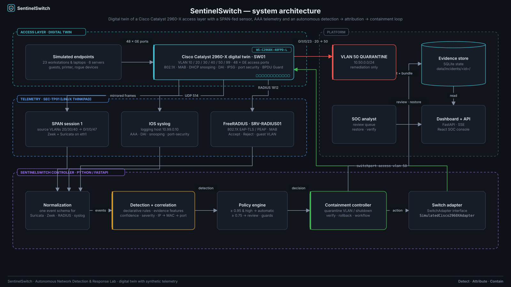

# Architecture

SentinelSwitch is a reproducible network-defense digital twin. It models the telemetry, detection,
attribution and containment pipeline of a Cisco Catalyst 2960-X access layer and ships with a
deterministic synthetic dataset so the complete incident lifecycle can be replayed without external
infrastructure.



## Components

| Layer | Component | Implementation | Notes |
| --- | --- | --- | --- |
| Access | Simulated endpoints | `simulator/fixtures/inventory.yaml` | 23 workstations/laptops, 6 servers, 4 infrastructure devices, 3 guest devices, 4 unregistered devices seen during the day |
| Access | Catalyst 2960-X digital twin (SW01) | `backend/sentinelswitch/simulator/twin.py` | Interfaces, VLANs, MAC table, DHCP snooping bindings, port security, err-disable, logging buffer, config changes |
| Access | IOS renderer | `backend/sentinelswitch/simulator/cli_render.py` | `show …` transcripts and the running configuration rendered from twin state |
| Telemetry | SPAN → Zeek + Suricata | `simulator/generators/{traffic,scenarios,zeek,suricata}.py` | VLAN SPAN (20/30/40) to SEC-TP01 `eth1`; Zeek conn/dns/ssl/http/notice/weird logs and Suricata EVE |
| Telemetry | IOS syslog | `simulator/generators/syslog.py` | Link, AAA, DAI, DHCP snooping, port-security, BPDU Guard and configuration messages |
| Telemetry | FreeRADIUS (802.1X / MAB) | `simulator/generators/radius.py` | EAP-TLS, PEAP-MSCHAPv2 and MAB results including guest-VLAN fallback |
| Detection | Normalization | `backend/sentinelswitch/detection/normalize.py` | One event schema for all four sources, enriched with port class and gateway context |
| Detection | Correlation rules | `detections/correlation/*.yaml`, `detection/engine.py` | Declarative triggers, aggregation windows and evidence features with additive confidence |
| Detection | Attribution | `backend/sentinelswitch/correlation/engine.py` | IP → DHCP binding → MAC → MAC table → interface → VLAN → identity, with explicit flags |
| Response | Policy engine | `automation/policies/containment-policy.yaml`, `containment/policy.py` | Tiers by confidence and severity, guards that can only downgrade |
| Response | Containment controller | `containment/controller.py` | Executes quarantine VLAN moves or administrative shutdowns, verifies, supports rollback |
| Response | Switch adapter | `containment/adapters.py` | `SwitchAdapter` interface; `SimulatedCisco2960XAdapter` ships |
| Platform | Evidence store | SQLite + `data/incidents/<id>/` | Operational state in SQLite, per-incident evidence bundles on disk |
| Platform | Dashboard + API | `backend/sentinelswitch/app`, `frontend/` | FastAPI with Server-Sent Events, React + TypeScript SOC console |

## Trust boundaries

1. **Endpoint ↔ switch port.** Everything below the access port is untrusted. 802.1X/MAB gates
   admission, port security pins the drop to an asset, DHCP snooping, DAI and IP Source Guard
   validate what the endpoint claims about itself. Only the two infrastructure trunks
   (`Gi1/0/1` to LAB-FW01, `Gi1/0/48` to SEC-TP01) are DHCP-snooping and DAI trusted.
2. **Switch ↔ security stack.** SEC-TP01 receives mirrored frames on a SPAN destination port that
   carries no production traffic, syslog on VLAN 99, and RADIUS exchanges through SRV-RADIUS01.
   The controller's write path to the switch is a single service account (`sentinel`) restricted by
   the management ACL and a parser view; the twin models the same restriction in the adapter guards.
3. **Detection ↔ response.** The policy engine is the only path to a switch change. It can only
   *downgrade* a disposition: protected ports, trunks, the SPAN destination, critical assets and
   unresolved attribution all force manual review. The adapter enforces the same rules again so a
   bug in policy evaluation cannot touch infrastructure ports.
4. **Quarantine VLAN.** VLAN 50 has its own subnet and reaches only the remediation service; the
   twin models it as an isolated VLAN with no SPAN coverage, which is why telemetry from a quarantined
   host disappears from the sensor feed.

## Physical story being modelled

* **Cisco Catalyst 2960-X, WS-C2960X-48FPD-L (SW01)** — the access layer. 48 × 10/100/1000 PoE+
  ports, 2 × SFP+ uplinks (unused in the lab), IOS 15.2(7)E8.
* **Linux security workstation (SEC-TP01)** — an older Lenovo ThinkPad running Debian 12. `eth0` is
  a trunk on `Gi1/0/48` (VLAN 10 management, VLAN 99 collector/controller); `eth1` is a USB NIC on the
  SPAN destination `Gi1/0/47` where Zeek and Suricata listen. It conceptually hosts the simulated
  endpoints as well; in the twin each endpoint is modelled on the dedicated access port it would use
  in the physical build-out.
* **LAB-FW01** — firewall/router on the protected trunk `Gi1/0/1`, gateway `.1` in every VLAN,
  DHCP relay to SRV-DC01.

## VLAN plan

| VLAN | Name | Subnet | Purpose | Snooping / DAI | SPAN |
| --- | --- | --- | --- | --- | --- |
| 10 | MGMT | 10.10.10.0/24 | switch SVI, jump host, PDU, SEC-TP01 management | no | no |
| 20 | USERS | 10.20.0.0/24 | workstations and laptops, 802.1X | yes | yes |
| 30 | SERVERS | 10.30.0.0/24 | directory, files, RADIUS, web, git, updates | yes (static bindings) | yes |
| 40 | GUEST | 10.40.0.0/24 | guest-VLAN fallback on conference drops | yes | yes |
| 50 | QUARANTINE | 10.50.0.0/24 | containment | yes | no |
| 99 | MONITORING | 10.99.0.0/24 | collector and controller | no | no |
| 999 | BLACKHOLE | — | unused ports and trunk native VLAN | — | — |

## Request flow in the application

```
browser ──HTTP/SSE──▶ FastAPI ──▶ Store (SQLite) ──▶ SwitchTwin (JSON in kv)
                          │
                          ├─ /api/demo/run ──▶ ScenarioRunner ──▶ DetectionEngine ──▶ CorrelationEngine
                          │                                         ──▶ PolicyEngine ──▶ ContainmentController ──▶ SimulatedCisco2960XAdapter
                          │                                         ──▶ evidence bundle (data/incidents/INC-2026-0042/)
                          └─ /api/switch/show ──▶ cli_render (IOS transcripts from the twin)
```

The same `ScenarioRunner` is used by the data generator (to replay the day's historical incidents),
by the CLI demo, by the API and by the validation harness. There is exactly one implementation of
every step, which is what keeps the numbers consistent across surfaces.

## Runtime state

* `data/seed/*.json` — the generated baseline (state at 21:14:00 UTC on the dataset day, just before
  the flagship incident). Committed.
* `data/generated/sentinelswitch.db` — SQLite working state. Not committed; rebuilt by `make seed`.
* `data/incidents/INC-2026-0039..0041/` — historical incidents produced by the day simulation.
  Committed. `INC-2026-0042/` is produced by `make demo` and removed by `make reset`.

## Related diagrams

* [Network topology](../diagrams/svg/network-topology.svg)
* [Detection → containment flow](../diagrams/svg/detection-to-containment-flow.svg)
* [Telemetry pipeline](../diagrams/svg/telemetry-pipeline.svg)
* [Flagship incident correlation flow](../diagrams/svg/incident-correlation-flow.svg)

Editable sources live in `diagrams/source/*.json`; `make diagrams` renders SVG, PNG and Mermaid.
